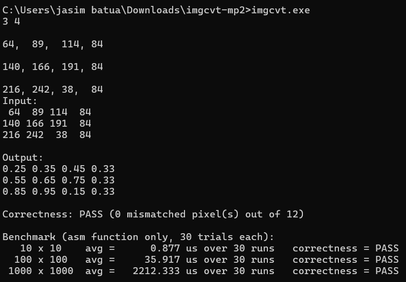

# LBYARCH---MP2
Jasim Sirad B. Batua - S25G
# imgCvtGrayIntToDouble

C + x86-64 Assembly (NASM) — Converts uint8 grayscale images to double-precision [0.0, 1.0].

What it does

Maps integer pixels (0–255) to floating-point using `f = i / 255.0`.
- Main.c - collects input, allocates memory, prints output, verifies correctness, benchmarks.
- imgcvt.asm - performs the conversion using scalar SSE2 instructions.

## Screenshot — Correctness Check

**Result:** `PASS` — 0 mismatched pixels.
| Image Size | Avg Time | Pixels | Per Pixel |
|------------|----------|--------|-----------|
| 10 × 10 | 0.877 µs | 100 | 8.77 ns |
| 100 × 100 | 35.917 µs | 10,000 | 3.59 ns |
| 1000 × 1000 | 2,212.333 µs | 1,000,000 | 2.21 ns |

Analysis
Performance Analysis

The execution time increases as the image size increases because more pixels need to be converted. Larger images take longer to process, but the increase is close to linear since the assembly function performs the same operations for every pixel.

The conversion uses scalar SSE2 instructions (`cvtsi2sd`, `mulsd`, and `movsd`) as required by the assignment. The program produced correct results for all test cases and passed the correctness check.

Video Demo
